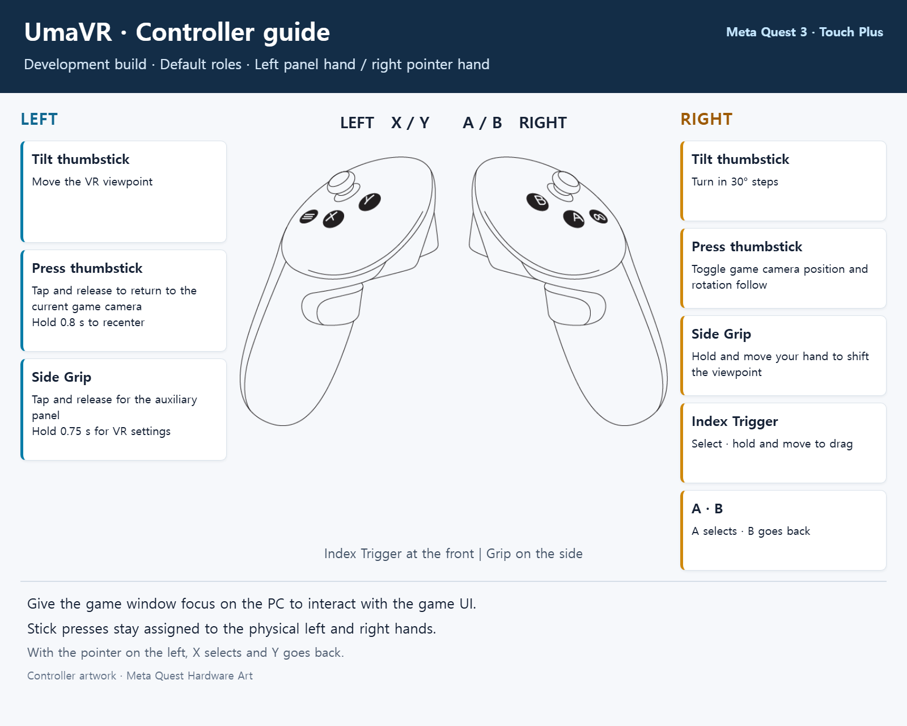

## [English](README.md) | [한국어](README.ko.md) | [日本語](README.ja.md)

## Requirements

Windows 11 x64, the DMM edition of Umamusume, Meta Quest controllers and a working PC OpenXR connection. The tested setup uses Direct3D 11, Virtual Desktop (VDXR) and Localify 1.50.0.

## Screens with VR 6DoF stereo

In [v0.1.13 (prerelease)](https://github.com/deadpixel134/umamusume-vr/releases/tag/v0.1.13), these screens have been checked in a headset with physical head rotation and translation:

- Home — the main screen with the character and background.
- Live — supported concert performances, once the stage appears.

Stereo rendering has also been observed during Career races and in the full-body view in Character Notes. Physical 6DoF has yet to be verified separately on those screens. Outfit Preview is experimental and is being retested for stereo entry and close-up clipping.

# UmaVR

Creator: [@TBluebox12](https://x.com/TBluebox12)  
Support: [buymeacoffee.com/vrshits](https://buymeacoffee.com/vrshits)

UmaVR is an unofficial Meta Quest/OpenXR VR mod for the DMM release of Umamusume: Pretty Derby. In stable v0.1.1, validated Live scenes use binocular VR and physical 6DoF; all other screens remain the complete aspect-correct original game image on a flat panel. The game UI can be operated with VR controllers.

The Virtual Desktop VDXR route has been tested on hardware. The current official version is **v0.1.1**.

[Download v0.1.1](https://github.com/deadpixel134/umamusume-vr/releases/tag/v0.1.1) · [Install, update or remove](docs/en/INSTALLATION.md) · [Controller guide](docs/en/CONTROLS.md)

## 1. Install

Close the game. Download `UmaVR-v0.1.1.zip` and its `.sha256` from the release assets. Extract the ZIP outside the game folder and run `UmaVR.Installer.exe`. Select the folder containing `umamusume.exe` and install. If Localify is missing, follow the installer’s Localify guide and refresh.

## 2. Launch in VR

Connect the headset to your PC and start your VDXR session. Launch Umamusume through DMM. The title and menus appear on a front panel. Enter a supported Live performance to see the stage in stereo with head tracking.

## 3. Display and controls

Aim at the game panel with the right controller. Trigger or A selects and drags, and B goes back. In Live, left Grip opens the auxiliary panel. In v0.1.1 the right stick moves and the left stick turns in 30° steps. The diagram below shows the current development defaults: left stick to move, right stick to turn in 30° steps.

## 4. Change settings

Close the game and open `vrmod/tools/UmaVR.Configurator.exe`. Set world scale to adjust the perceived size of the stage, and eye render scale to adjust image resolution. Save your changes before launching again.

## 5. Update

Close the game and open `vrmod/tools/UmaVR.Configurator.exe`. The v0.1.1 configurator checks for a newer public release at startup. Select **Check for updates** to check again. When an update is available, it verifies the ZIP and launches the installer automatically.

To update manually, extract the new ZIP from [Releases](https://github.com/deadpixel134/umamusume-vr/releases) outside the game directory. Run its `UmaVR.Installer.exe` and select your existing game folder.

[Update steps and error messages](docs/en/UPDATE.md)

## Uninstall or roll back

Close the game, reopen the package installer and choose removal or rollback. The installer preserves user settings and checks backups before restoring files.

## Troubleshooting

If a panel is visible but clicks do nothing, focus the game window on your PC. If the headset has no image, check the active OpenXR runtime before restarting the game.

## Documentation

- [Install, update or remove](docs/en/INSTALLATION.md)
- [Usage](docs/en/USAGE.md)
- [Controller guide](docs/en/CONTROLS.md)
- [Settings](docs/en/SETTINGS.md)
- [Updates](docs/en/UPDATE.md)
- [Troubleshooting](docs/en/TROUBLESHOOTING.md)
- [Release notes](docs/en/RELEASE_NOTES.md)
- [Architecture](docs/en/ARCHITECTURE.md)

## Current support boundary

- Validated: Windows 11 x64, game 2.30.0, Unity 2022.3.62f2, Direct3D 11, Virtual Desktop VDXR 1.0.10 and the Localify 1.50.0 loader route
- Live supports immersive stereo, 6DoF, VFX and controllers.
- v0.1.1 — Home, Story, Race, Training and character preview remain PANEL because no safe stereo ownership route is available.
- SteamVR OpenXR and Meta Quest Link/Air Link are provisional and have not been tested in this project.

The current release requires an existing compatible `localify.dll` and its `config.json` `externalDlls` loader. If it is not detected, use the [official Localify installation guide](https://github.com/Kimjio/umamusume-localify) linked by the installer. Public GitHub Releases are accessed without authentication, and no reusable GitHub credential is shipped.

## Credits

- [umamusume-localify](https://github.com/Kimjio/umamusume-localify) — the Localify loader and `externalDlls` integration used by UmaVR

This repository excludes original game files, Localify files, user settings, logs, rollback data, build outputs and credentials. Source is provided under the [GNU General Public License v3.0 (GPL-3.0-only)](LICENSE). Components incorporated into distributed binaries are covered by the [Third-Party Notices](THIRD_PARTY_NOTICES.txt) and the packaged .NET notices.

See the [release source instructions](docs/RELEASING-SOURCE.md) for corresponding source.

> UmaVR is an unofficial fan project with no affiliation to the game developer or publisher. A legitimate installation of the game is required.
