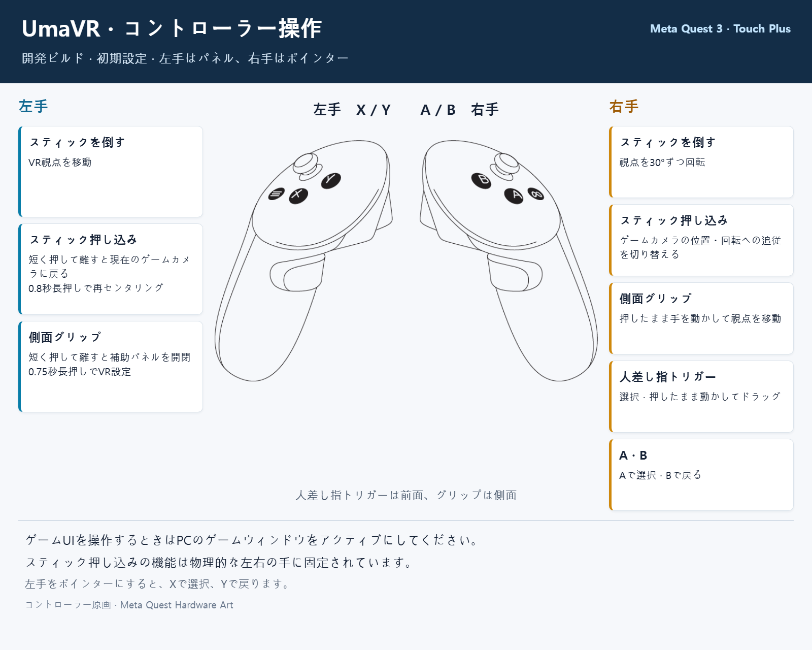

## [English](README.md) | [한국어](README.ko.md) | [日本語](README.ja.md)

## 必要環境

Windows 11 x64、DMM版ウマ娘、Meta Questコントローラー、PC OpenXR環境が必要です。実機で確認した構成はDirect3D 11、Virtual Desktop（VDXR）、Localify 1.50.0です。

## VR 6DoFステレオ対応画面

[v0.1.13（プレリリース）](https://github.com/deadpixel134/umamusume-vr/releases/tag/v0.1.13)が対応する画面のうち、頭の回転と実際の位置移動に視点が追従することを実機で確認した画面です。

- ホーム — キャラクターと背景が表示されるメイン画面
- ライブ — 対応する公演のステージ画面

育成レースとウマ娘名鑑の全身表示でも立体表示を確認しています。この2画面での物理6DoFは個別検証待ちです。衣装プレビューは試験対応で、立体表示への切り替えと近距離でのモデルの欠けを再検証中です。

# UmaVR

制作者: [@TBluebox12](https://x.com/TBluebox12)  
支援: [buymeacoffee.com/vrshits](https://buymeacoffee.com/vrshits)

UmaVRは、DMM版『ウマ娘 プリティーダービー』向けの非公式Meta Quest/OpenXR VR Modです。安定版v0.1.1では、検証済みのLiveで両眼VRと物理6DoFを使用し、それ以外の画面は元の比率を維持した完全なゲーム画面を平面パネルで表示します。VRコントローラーでゲームUIを操作できます。

Virtual DesktopのVDXR経路で実機検証済みです。現在の公式バージョンは**v0.1.1**です。

[v0.1.1をダウンロード](https://github.com/deadpixel134/umamusume-vr/releases/tag/v0.1.1) · [インストール・更新・削除](docs/ja/INSTALLATION.md) · [操作ガイド](docs/ja/CONTROLS.md)

## 1. インストール

ゲームを終了し、リリースのAssetsから `UmaVR-v0.1.1.zip` と `.sha256` を取得します。ゲームフォルダーの外に展開し、`UmaVR.Installer.exe` を実行します。`umamusume.exe` のあるフォルダーを選んでインストールします。Localifyが見つからない場合はインストーラーの案内に従って導入し、再読み込みします。

## 2. VRで起動

ヘッドセットをPCに接続し、VDXRセッションを開始してからDMMでウマ娘を起動します。タイトルとメニューは正面パネルに表示されます。対応するライブに入ると頭の動きに合わせてステージを立体視できます。

## 3. 画面と操作

右手でゲームパネルを指し、トリガーまたはAで選択・ドラッグ、Bで戻ります。ライブ中は左グリップで補助パネルを開きます。公開版v0.1.1では右スティックで移動し、左スティックで30°ずつ回転します。下図は現在の開発ビルドの初期配置です。左スティックで移動し、右スティックで30°ずつ回転します。

## 4. 設定の変更

ゲームを終了し、`vrmod/tools/UmaVR.Configurator.exe` を開きます。ステージの見かけの大きさはワールドスケール、映像の解像度は両眼の描画倍率で調整します。設定を保存してからゲームを再起動します。

## 5. アップデート

ゲームを終了して `vrmod/tools/UmaVR.Configurator.exe` を開きます。公開版v0.1.1は起動時に新しい公開版を確認します。再確認するには **更新を確認** を選びます。更新がある場合はZIPを検証してインストーラーを自動起動します。

手動で更新するには、[Releases](https://github.com/deadpixel134/umamusume-vr/releases) の新しいZIPをゲームフォルダーの外に展開します。同梱の `UmaVR.Installer.exe` を実行し、既存のゲームフォルダーを選んでインストールします。

[更新手順とエラーの確認](docs/ja/UPDATE.md)

## 削除とロールバック

ゲームを終了し、パッケージのインストーラーから削除またはロールバックを選びます。ユーザー設定は保持され、ファイル復元前にバックアップが確認されます。

## トラブルシューティング

カーソルが動いても選択できない場合は、PCのゲームウィンドウをアクティブにしてください。ヘッドセットに映像が出ない場合は、有効なOpenXRランタイムを確認してからゲームを再起動してください。

## 関連ドキュメント

- [インストール・更新・削除](docs/ja/INSTALLATION.md)
- [使い方](docs/ja/USAGE.md)
- [操作ガイド](docs/ja/CONTROLS.md)
- [設定](docs/ja/SETTINGS.md)
- [アップデート](docs/ja/UPDATE.md)
- [トラブルシューティング](docs/ja/TROUBLESHOOTING.md)
- [リリースノート](docs/ja/RELEASE_NOTES.md)
- [構成](docs/ja/ARCHITECTURE.md)

## 現在の対応範囲

- 検証済み: Windows 11 x64、ゲーム2.30.0、Unity 2022.3.62f2、Direct3D 11、Virtual Desktop VDXR 1.0.10、Localify 1.50.0ローダー経路
- Liveはimmersive stereo/6DoF/VFX/コントローラーに対応します。
- v0.1.1 — Home,Story、Race、Training、キャラクタープレビューは安全なステレオ所有経路がないためPANEL表示です。
- SteamVR OpenXRとMeta Quest Link/Air Linkは暫定対応で、本プロジェクトでは未検証です。

現在のリリースは互換性のある既存`localify.dll`と`config.json`の`externalDlls`ローダーを必要とします。検出されない場合は、インストーラーに表示される[公式Localifyインストール案内](https://github.com/Kimjio/umamusume-localify)を先に確認してください。公開GitHub Releaseには認証なしでアクセスし、再利用可能なGitHub認証情報は配布しません。

## Credits

- [umamusume-localify](https://github.com/Kimjio/umamusume-localify) — UmaVRが使用するLocalifyローダーと`externalDlls`統合の基盤

ゲーム原本、Localifyファイル、ユーザー設定、ログ、ロールバックデータ、ビルド成果物、認証情報はリポジトリに含めません。ソースは[GNU General Public License v3.0 (GPL-3.0-only)](LICENSE)で提供し、配布バイナリに組み込まれた外部コンポーネントには[Third-Party Notices](THIRD_PARTY_NOTICES.txt)とパッケージ内の.NET通知が適用されます。

> UmaVRは非公式ファンプロジェクトであり、ゲーム開発・配信会社とは関係ありません。正規にインストールしたゲームが必要です。
