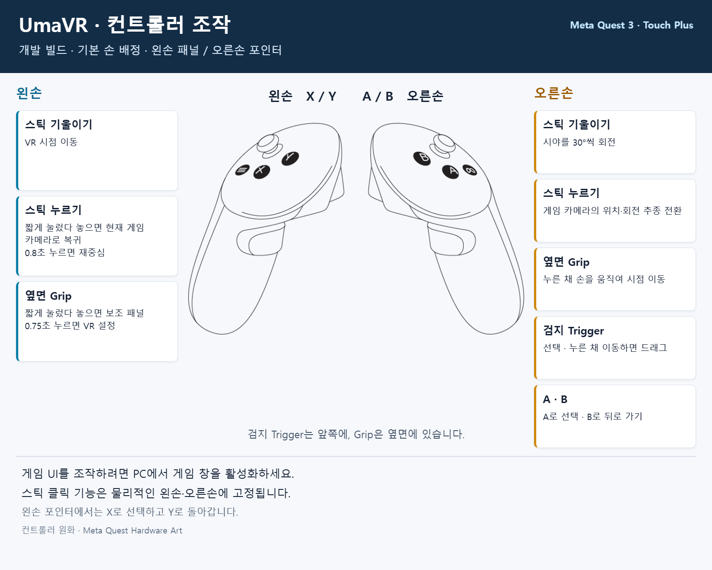

## [English](README.md) | [한국어](README.ko.md) | [日本語](README.ja.md)

## 준비물

Windows 11 x64, DMM판 우마무스메, Meta Quest 컨트롤러와 PC OpenXR 환경이 필요합니다. 실기로 확인한 조합은 Direct3D 11, Virtual Desktop(VDXR), Localify 1.50.0입니다.

## VR 6DoF 스테레오 지원 화면

[v0.1.13](https://github.com/deadpixel134/umamusume-vr/releases/tag/v0.1.13)에서 사용하는 화면 중, HMD를 돌리거나 실제로 몸을 옮겼을 때 시점이 따라오는 것을 확인한 화면입니다.

- 홈 — 캐릭터와 배경이 함께 보이는 메인 화면
- 라이브 — 지원되는 공연의 무대 화면

육성 레이스와 캐릭터 노트의 전신 보기에서도 입체 표시를 확인했습니다. 두 화면의 물리 6DoF 동작은 개별 검증 전입니다. 의상 미리보기는 실험 단계로, 입체 진입과 가까운 거리에서 모델이 잘리는 현상을 재검증하고 있습니다.

# UmaVR

제작자: [@TBluebox12](https://x.com/TBluebox12)  
아카라이브 가상현실 채널: [가상현실 채널](https://arca.live/b/vrshits)  
후원: [buymeacoffee.com/vrshits](https://buymeacoffee.com/vrshits)

우마무스메 프리티 더비 DMM판을 위한 비공식 Meta Quest/OpenXR VR 모드입니다. VR 컨트롤러로 게임 UI를 조작할 수 있습니다.

Virtual Desktop의 VDXR 경로로 실기 검증했습니다. 현재 공식 버전은 **v0.1.13**입니다.

[v0.1.13 다운로드](https://github.com/deadpixel134/umamusume-vr/releases/tag/v0.1.13) · [설치·업데이트·제거](docs/ko/INSTALLATION.md) · [컨트롤러 조작](docs/ko/CONTROLS.md)

## 1. 설치하기

게임을 종료합니다. 릴리스의 Assets에서 `UmaVR-v0.1.13.zip`과 `.sha256`을 받고 게임 폴더 밖에 압축을 풉니다. `UmaVR.Installer.exe`를 열고 `umamusume.exe`가 있는 폴더를 선택해 설치합니다. Localify가 감지되지 않으면 설치기에 표시된 안내에 따라 설치한 뒤 새로고침합니다.

## 2. VR로 실행하기

헤드셋을 PC에 연결하고 VDXR 세션을 시작한 뒤 DMM에서 우마무스메를 실행합니다. 타이틀과 메뉴는 정면 패널에 표시됩니다. 지원되는 라이브에 입장하면 머리 움직임에 따라 무대를 입체로 볼 수 있습니다.

## 3. 화면과 조작 익히기

VR 손과 캐릭터 사이의 충돌을 판정해 접촉 시 캐릭터가 움직이고 컨트롤러가 진동합니다. 사용하려면 설정 프로그램에서 캐릭터 접촉 안내를 끝까지 읽고 한 번 동의한 뒤 게임을 시작하세요.

오른손으로 게임 패널을 가리킵니다. Trigger 또는 A로 선택·드래그하고 B로 돌아갑니다. 라이브에서는 왼손 Grip으로 보조 패널을 엽니다. 왼쪽 스틱으로 이동하고 오른쪽 스틱으로 30°씩 회전합니다.

## 4. 설정 바꾸기

게임을 종료하고 `vrmod/tools/UmaVR.Configurator.exe`를 엽니다. 무대가 너무 크거나 작게 보이면 월드 스케일을, 영상 해상도를 바꾸려면 눈별 렌더 배율을 조절합니다. 저장한 뒤 게임을 다시 실행합니다.

## 5. 업데이트하기

게임을 완전히 종료하고 `vrmod/tools/UmaVR.Configurator.exe`를 엽니다. 공개판 v0.1.13은 시작할 때 새 공개판을 확인하며, **업데이트 확인**으로 다시 조회할 수 있습니다. 새 버전을 선택해 적용하면 ZIP을 검증한 뒤 설치기를 실행합니다.

수동으로 진행하려면 [Releases](https://github.com/deadpixel134/umamusume-vr/releases)의 새 버전 ZIP을 게임 폴더 밖에 풀고, 해당 `UmaVR.Installer.exe`에서 기존 게임 폴더를 선택해 설치하세요.

[업데이트 절차와 오류 확인](docs/ko/UPDATE.md)

## 제거와 롤백

게임 종료 후 패키지 설치기를 다시 열어 제거 또는 롤백을 선택합니다. 설치기는 사용자 설정을 보존하며, 파일을 복원하기 전에 백업을 확인합니다.

## 문제 해결

패널의 커서는 움직이는데 클릭이 안 되면 PC에서 게임 창을 선택하세요. 헤드셋에 화면이 뜨지 않으면 활성 OpenXR 런타임을 확인하고 게임을 다시 시작하세요.

## 관련 문서

- [설치·업데이트·제거](docs/ko/INSTALLATION.md)
- [사용 방법](docs/ko/USAGE.md)
- [컨트롤러 조작](docs/ko/CONTROLS.md)
- [설정](docs/ko/SETTINGS.md)
- [업데이트](docs/ko/UPDATE.md)
- [문제 해결](docs/ko/TROUBLESHOOTING.md)
- [릴리스 정보](docs/ko/RELEASE_NOTES.md)
- [프로그램 구조](docs/ko/ARCHITECTURE.md)

## 현재 지원 경계

- 검증됨: Windows 11 x64, 게임 2.30.0, Unity 2022.3.62f2, Direct3D 11, Virtual Desktop VDXR 1.0.10, Localify 1.50.0 로더 경로
- Live: immersive stereo/6DoF/VFX/컨트롤러 지원
- SteamVR OpenXR와 Meta Quest Link/Air Link: 예비 지원, 이 프로젝트에서 실기 미검증
- 전체 post-processing OFF는 잔여 흐림 제거가 검증되었습니다. 일부 효과는 개별 제어가 제한되며 Aura는 개별 비활성화를 지원하지 않습니다.

## 주의 사항

- 현재 릴리스는 기존 `localify.dll`과 `config.json`의 `externalDlls` 로더를 사용합니다. 감지되지 않으면 설치 프로그램에 표시되는 [공식 Localify 설치 안내](https://github.com/Kimjio/umamusume-localify)를 먼저 확인하세요. clean-game standalone loader는 아직 완료되지 않았습니다.
- 설치기는 게임 실행 중 파일을 교체하지 않으며, payload 전체를 먼저 검증합니다. 실패하면 현재 설치를 변경하지 않는 것이 목표입니다.
- 공개 GitHub Release는 인증 정보 없이 조회합니다. 프로그램과 패키지에는 GitHub 토큰이나 재사용 가능한 자격 증명을 포함하지 않습니다.

## Credits

- [umamusume-localify](https://github.com/Kimjio/umamusume-localify) — UmaVR가 사용하는 Localify 로더 및 `externalDlls` 통합 기반

이 저장소에는 게임 원본 파일, Localify 파일, 사용자 설정, 로그, 롤백 데이터, 빌드 산출물과 인증 정보를 포함하지 않습니다. 프로젝트 소스는 [GNU General Public License v3.0 (GPL-3.0-only)](LICENSE)로 배포되며, 배포 바이너리에 포함된 외부 구성 요소는 [Third-Party Notices](THIRD_PARTY_NOTICES.txt)와 패키지의 .NET 고지를 따릅니다.

> UmaVR은 비공식 팬 프로젝트이며 게임 개발사·배급사와 관련이 없습니다. 게임과 관련 상표·저작물의 권리는 각 권리자에게 있습니다. 사용하려면 정식으로 설치한 게임이 필요합니다.
