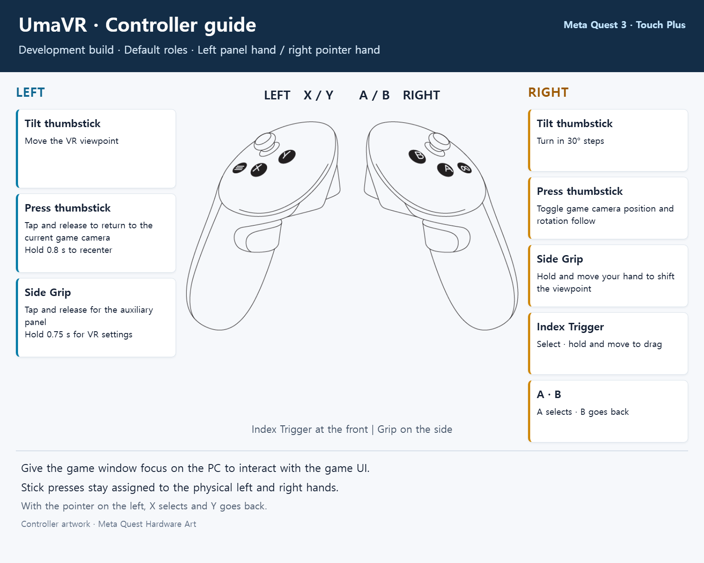
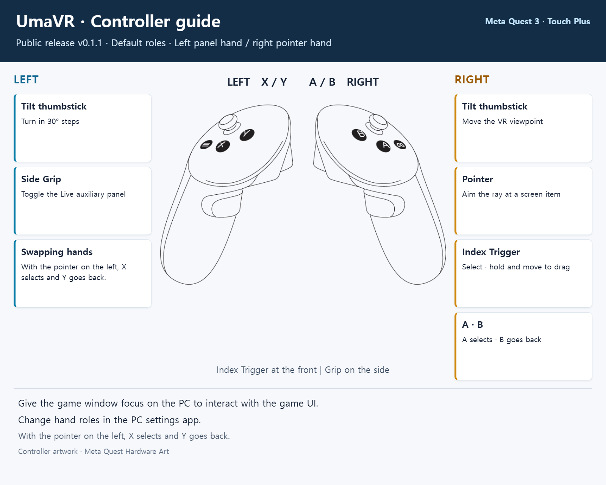

[한국어](../ko/CONTROLS.md) | [English](../en/CONTROLS.md) | [日本語](../ja/CONTROLS.md)

# Controller guide

[UmaVR](../../README.md) · [Usage](USAGE.md) · [Installation, updates and removal](INSTALLATION.md)

## Development build

| Input | Action |
|---|---|
| LEFT · Tilt thumbstick | Move the VR viewpoint |
| LEFT · Press thumbstick | Tap and release to return to the current game camera · Hold 0.8 s to recenter |
| LEFT · Side Grip | Tap and release for the auxiliary panel · Hold 0.75 s for VR settings |
| RIGHT · Tilt thumbstick | Turn in 30° steps |
| RIGHT · Press thumbstick | Toggle game camera position and rotation follow |
| RIGHT · Side Grip | Hold and move your hand to shift the viewpoint |
| RIGHT · Index Trigger | Select · hold and move to drag |
| RIGHT · A · B | A selects · B goes back |

In the development build you can choose the movement stick, world-grab button and tracked hand. When a panel is open, UI input takes priority. Stick presses stay assigned to the physical left and right hands.

## Public release v0.1.1

| Input | Action |
|---|---|
| LEFT · Tilt thumbstick | Turn in 30° steps |
| LEFT · Side Grip | Toggle the Live auxiliary panel |
| RIGHT · Tilt thumbstick | Move the VR viewpoint |
| RIGHT · Pointer | Aim the ray at a screen item |
| RIGHT · Index Trigger | Select · hold and move to drag |
| RIGHT · A · B | A selects · B goes back |

Give the game window focus on the PC to interact with the game UI. With the pointer on the left, X selects and Y goes back.
