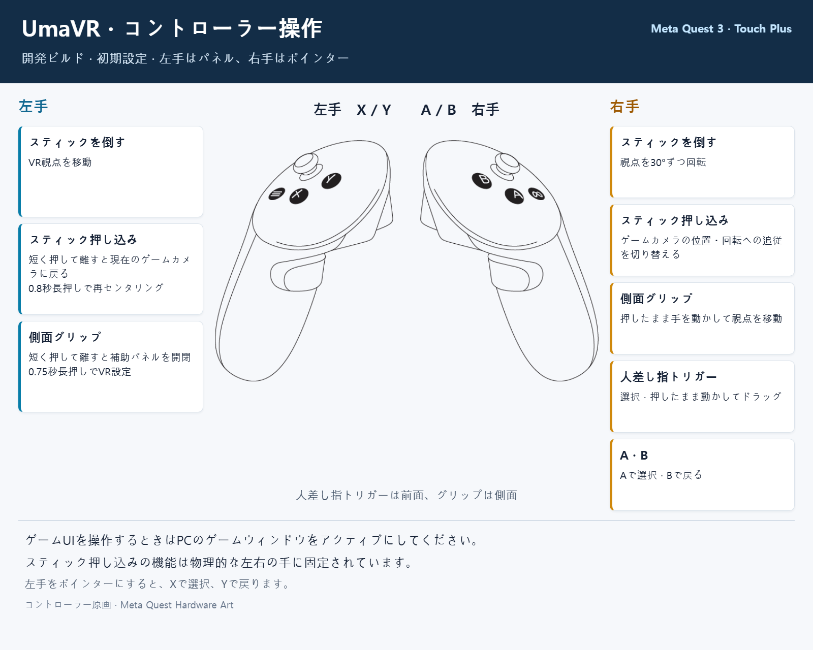
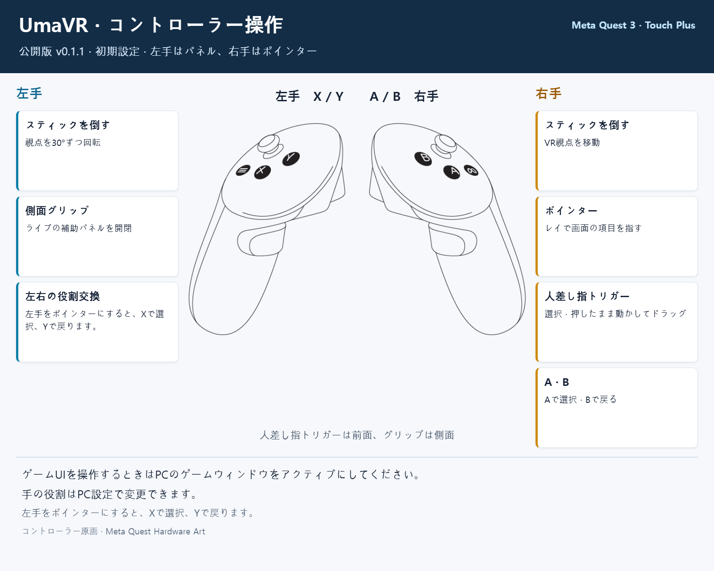

[한국어](../ko/CONTROLS.md) | [English](../en/CONTROLS.md) | [日本語](../ja/CONTROLS.md)

# コントローラー操作

[UmaVR](../../README.ja.md) · [使い方](USAGE.md) · [インストール・更新・削除](INSTALLATION.md)

## 開発ビルド

| 入力 | 操作 |
|---|---|
| 左手 · スティックを倒す | VR視点を移動 |
| 左手 · スティック押し込み | 短く押して離すと現在のゲームカメラに戻る · 0.8秒長押しで再センタリング |
| 左手 · 側面グリップ | 短く押して離すと補助パネルを開閉 · 0.75秒長押しでVR設定 |
| 右手 · スティックを倒す | 視点を30°ずつ回転 |
| 右手 · スティック押し込み | ゲームカメラの位置・回転への追従を切り替える |
| 右手 · 側面グリップ | 押したまま手を動かして視点を移動 |
| 右手 · 人差し指トリガー | 選択 · 押したまま動かしてドラッグ |
| 右手 · A · B | Aで選択 · Bで戻る |

開発ビルドでは移動用スティック、ワールド移動のボタン、追跡する手を選べます。パネルを開いている間はUI操作が優先されます。 スティック押し込みの機能は物理的な左右の手に固定されています。

## 公開版 v0.1.1

| 入力 | 操作 |
|---|---|
| 左手 · スティックを倒す | 視点を30°ずつ回転 |
| 左手 · 側面グリップ | ライブの補助パネルを開閉 |
| 右手 · スティックを倒す | VR視点を移動 |
| 右手 · ポインター | レイで画面の項目を指す |
| 右手 · 人差し指トリガー | 選択 · 押したまま動かしてドラッグ |
| 右手 · A · B | Aで選択 · Bで戻る |

ゲームUIを操作するときはPCのゲームウィンドウをアクティブにしてください。 左手をポインターにすると、Xで選択、Yで戻ります。
