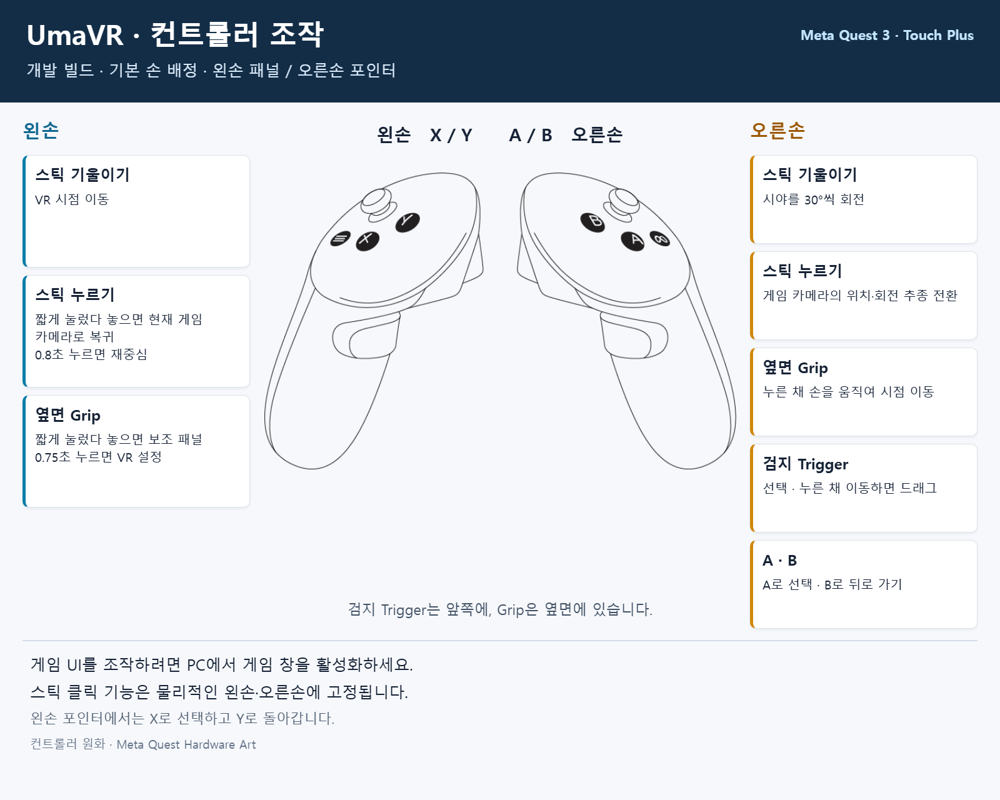
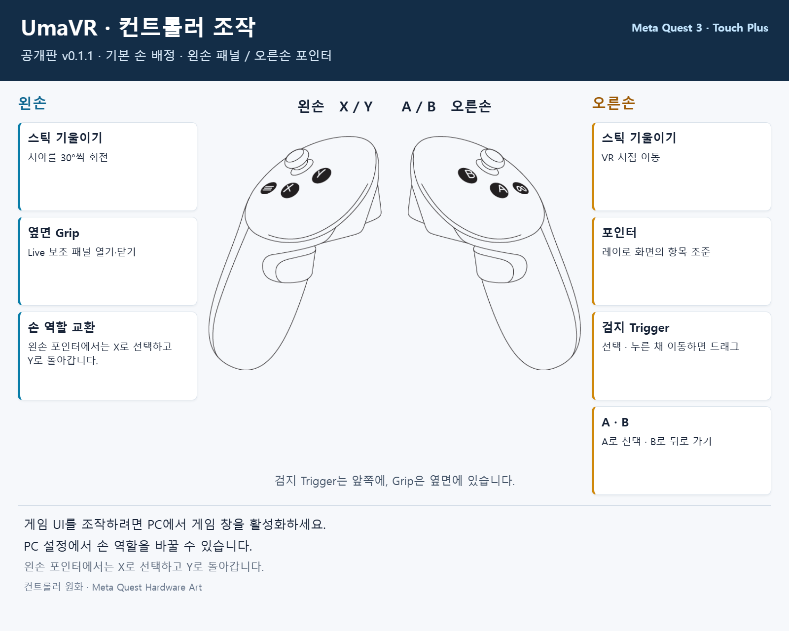

[한국어](../ko/CONTROLS.md) | [English](../en/CONTROLS.md) | [日本語](../ja/CONTROLS.md)

# 컨트롤러 조작

[UmaVR](../../README.ko.md) · [사용 방법](USAGE.md) · [설치·업데이트·제거](INSTALLATION.md)

## 개발 빌드

| 입력 | 동작 |
|---|---|
| 왼손 · 스틱 기울이기 | VR 시점 이동 |
| 왼손 · 스틱 누르기 | 짧게 눌렀다 놓으면 현재 게임 카메라로 복귀 · 0.8초 누르면 재중심 |
| 왼손 · 옆면 Grip | 짧게 눌렀다 놓으면 보조 패널 · 0.75초 누르면 VR 설정 |
| 오른손 · 스틱 기울이기 | 시야를 30°씩 회전 |
| 오른손 · 스틱 누르기 | 게임 카메라의 위치·회전 추종 전환 |
| 오른손 · 옆면 Grip | 누른 채 손을 움직여 시점 이동 |
| 오른손 · 검지 Trigger | 선택 · 누른 채 이동하면 드래그 |
| 오른손 · A · B | A로 선택 · B로 뒤로 가기 |

개발 빌드는 이동 스틱, 월드 잡기 버튼과 추적 손을 설정할 수 있습니다. 패널이 열려 있으면 UI 조작이 우선합니다. 스틱 클릭 기능은 물리적인 왼손·오른손에 고정됩니다.

## 공개판 v0.1.1

| 입력 | 동작 |
|---|---|
| 왼손 · 스틱 기울이기 | 시야를 30°씩 회전 |
| 왼손 · 옆면 Grip | Live 보조 패널 열기·닫기 |
| 오른손 · 스틱 기울이기 | VR 시점 이동 |
| 오른손 · 포인터 | 레이로 화면의 항목 조준 |
| 오른손 · 검지 Trigger | 선택 · 누른 채 이동하면 드래그 |
| 오른손 · A · B | A로 선택 · B로 뒤로 가기 |

게임 UI를 조작하려면 PC에서 게임 창을 활성화하세요. 왼손 포인터에서는 X로 선택하고 Y로 돌아갑니다.
